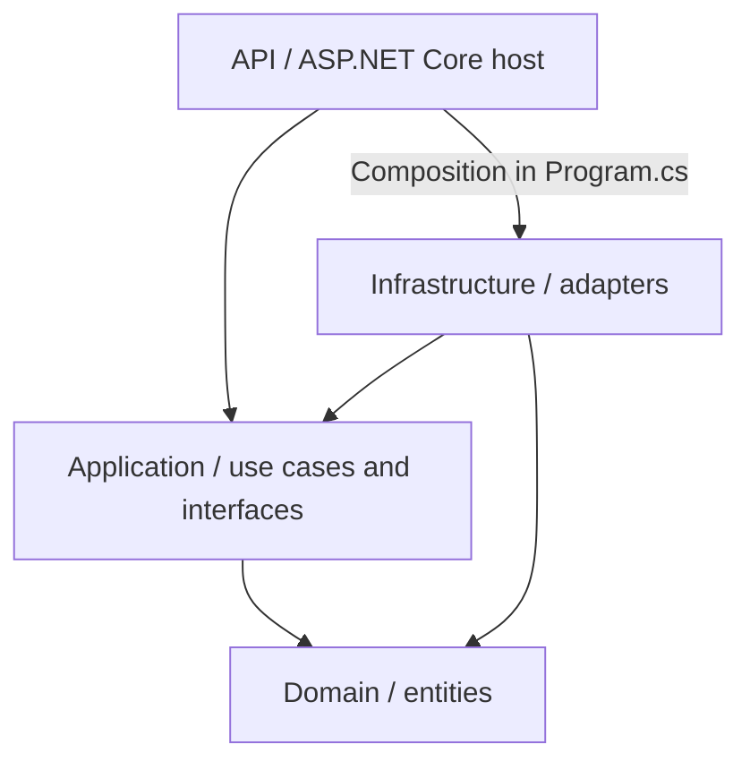
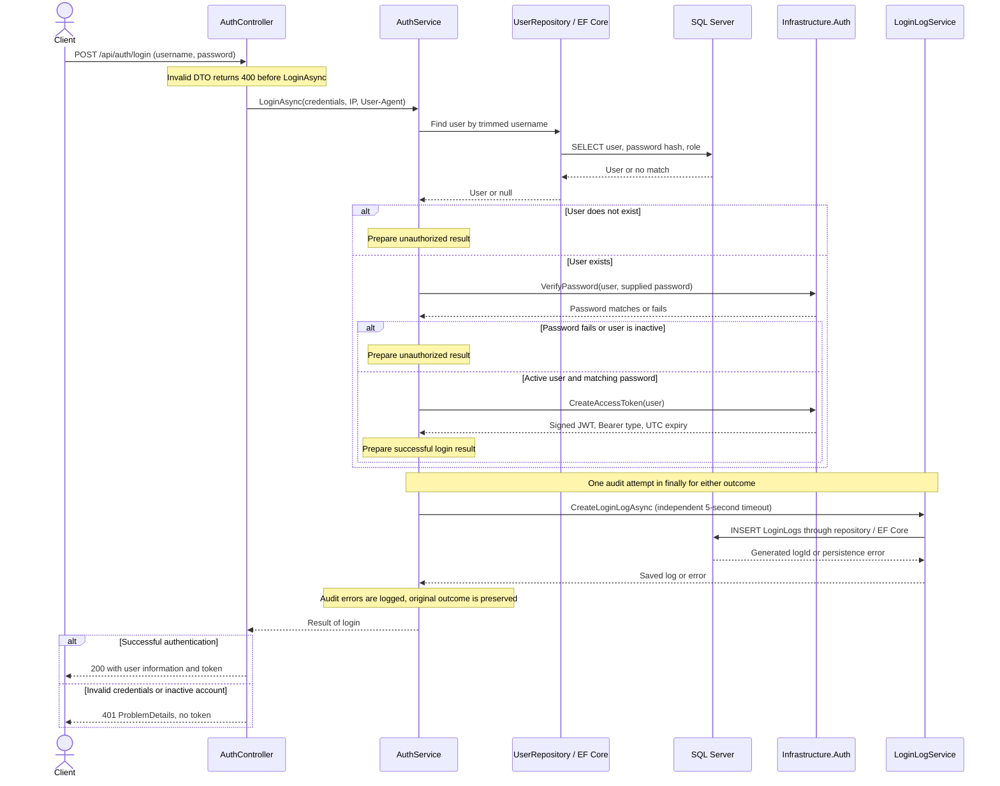
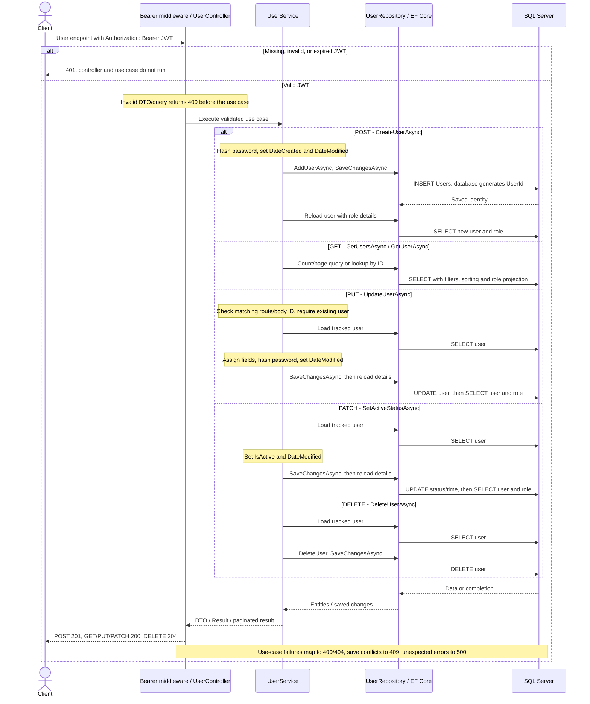

# portfolio-users-rest-api

An ASP.NET Core REST API for authenticating users and managing user records. It uses .NET 10, Entity Framework Core 10, SQL Server, JWT bearer authentication, and Swagger/OpenAPI.

The solution follows clean architecture: **Domain defines the entities, Application defines the use cases and contracts, Infrastructure implements external details, and the API handles HTTP and wires everything together.**

## Run locally

Prerequisites: the .NET 10 SDK, a reachable SQL Server instance, and a SQL client for running the scripts in `SQL/`.

1. Create a database named `UserDB` in SQL Server. For a new database, run these scripts in order:

   | Script | Purpose |
   | --- | --- |
   | [`SQL/Users-table-creation.sql`](SQL/Users-table-creation.sql) | Create `UserRole` and `Users`. Run with `UserDB` selected. |
   | [`SQL/Users-table-population.example.sql`](SQL/Users-table-population.example.sql) | Copy to `SQL/Users-table-population.local.sql`, replace `<seed-username>` and `<identity-password-hash>` with your own username and ASP.NET Core Identity password hash, then run the local copy to insert the Admin/User roles and first account. |
   | [`SQL/LoginLogs-table-creation.sql`](SQL/LoginLogs-table-creation.sql) | Create `dbo.LoginLogs` if it does not already exist. |

   Run the table-creation and customized user-population scripts once on a fresh database; they are not fully idempotent. `Users-add-userroleid-column.sql` is an upgrade helper for older schemas. Local seed data and the password-column upgrade script contain a private password hash and are excluded from Git. The API does **not** create databases, apply migrations, or seed data on startup.

2. Copy the sanitized settings template to the ignored local configuration file, then configure the connection and JWT signing key. ASP.NET Core loads `appsettings.json`, environment-specific settings, and environment-variable overrides. Replace the placeholders with your local values:

   ```sh
   cp appsettings.example.json appsettings.json
   export ConnectionStrings__UserDBConn='Server=<sql-host>,<sql-port>;Database=UserDB;User ID=<sql-user>;Password=<sql-password>;TrustServerCertificate=True;'
   export Jwt__SigningKey="$(openssl rand -hex 32)"
   ```

   `TrustServerCertificate=True` is for the local SQL Server setup. The public settings template has no connection string or signing key. Keep your values in ignored `appsettings.json` / `appsettings.Development.json` or environment variables; keep the generated signing key stable between runs if existing tokens should remain valid. For a local browser client, set `Cors__AllowedOrigins__0=http://localhost:5173` as needed.

3. Restore, build, and start the HTTPS launch profile:

   ```sh
   dotnet restore portfolio-users-rest-api.slnx
   dotnet build portfolio-users-rest-api.slnx --no-restore
   dotnet dev-certs https --trust
   dotnet run --project portfolio-users-rest-api.csproj --launch-profile https
   ```

   The HTTPS API is at `https://localhost:7132`; Swagger is at `https://localhost:7132/swagger` in Development. The `http` launch profile uses `http://localhost:5001`.

4. Log in with the account you created in your local SQL seed, then send the returned bearer token with protected requests. Set your own `seedUserName` / `seedUserPass` in a local Postman environment. User creation requires authentication, so the customized SQL seed supplies the first account; no shared seed login is published.

For the initial project setup walkthrough, see the [.NET 10 / EF Core tutorial](docs/dotnet-10-ef-core-setup-tutorial.md).

## Project structure

```text
portfolio-users-rest-api/
├── portfolio-users-rest-api.csproj             # ASP.NET Core host / API layer
├── Program.cs                         # Composition root and HTTP middleware
├── ApiExceptionHandler.cs             # Exception-to-ProblemDetails mapping
├── Controllers/
│   ├── AuthController.cs              # Anonymous login
│   ├── UserController.cs              # Protected user CRUD
│   ├── LoginLogsController.cs         # Protected explicit log creation
│   └── ControllerResultExtensions.cs  # Application Result -> HTTP response
├── src/
│   ├── Domain/
│   │   └── Entities/                  # User, UserRole, LoginLogs
│   ├── Application/
│   │   ├── Auth/                      # Login use case, DTOs, security contracts
│   │   ├── Users/                     # CRUD use cases, DTOs, repository contract
│   │   ├── LoginLogs/                 # Log use case, DTOs, repository contract
│   │   ├── Common/                    # Results, pagination, conflict exceptions
│   │   └── DependencyInjection/       # AddApplication()
│   └── Infrastructure/
│       ├── Auth/                      # Identity hashing, JWT generation/options
│       ├── Persistence/               # EF Core context and repository adapters
│       └── DependencyInjection/       # AddInfrastructure(configuration)
├── SQL/                               # Explicit schema and seed scripts
├── tests/UsersApi.Tests/               # Automated regression tests
├── test/postman/                       # Existing HTTP collection/environment
└── docs/                              # Setup and workflow walkthroughs
```

## Clean architecture

| Layer | Responsibility | Examples |
| --- | --- | --- |
| **Domain** | Represent the data and relationships without web or database implementation dependencies. | `User`, `UserRole`, `LoginLogs` |
| **Application** | Execute use cases; define DTOs, results, and the interfaces those use cases need. | `AuthService`, `UserService`, `IUserRepository`, `IUserPasswordHasher`, `IJwtTokenService` |
| **Infrastructure** | Implement application interfaces using frameworks and external systems. | `UserRepository`, `UsersDbContext`, `IdentityUserPasswordHasher`, `JwtTokenService` |
| **API** | Bind and validate HTTP input, enforce bearer authentication, call use cases, and map outcomes to HTTP. Compose dependencies at startup. | Controllers, `Program.cs`, `ApiExceptionHandler` |

Arrows below mean **compile-time project references**, rather than the order of an HTTP request:



Domain has no project or package dependencies. Application references Domain and general DI/logging abstractions; it does not reference Infrastructure, EF Core, or ASP.NET Core Identity. Infrastructure depends inward on Application and Domain. The API references Infrastructure to register concrete adapters; controllers depend on application services.

At runtime, `UserService` calls `IUserRepository`, which DI resolves to `UserRepository`. This is dependency inversion: Application owns the contract while Infrastructure supplies the implementation. The runtime call can reach SQL Server without Application knowing about `DbContext` or SQL.

The same boundary applies to security and errors:

- Application requests hashing through `IUserPasswordHasher`; Infrastructure wraps Identity's `PasswordHasher<User>`, preserving the existing stored-hash format.
- Application requests token creation through `IJwtTokenService`; Infrastructure creates the JWT.
- Infrastructure translates EF save errors into `PersistenceConflictException` or `ConcurrencyConflictException`. The API maps those application exceptions to `409` without depending on EF exception types.

This is a small service-and-repository design; it does not require a mediator, CQRS, or a generic repository to maintain the dependency rule. For background, see Microsoft's [clean architecture guidance](https://learn.microsoft.com/en-us/dotnet/architecture/modern-web-apps-azure/common-web-application-architectures#clean-architecture).

## Dependency injection

[`Program.cs`](Program.cs) is the **composition root**: the place where the running host assembles its dependencies. It registers controllers, authentication/authorization, CORS, Swagger, validation responses, and exception handling, then calls:

```csharp
builder.Services.AddApplication();
builder.Services.AddInfrastructure(builder.Configuration);
```

Constructor injection supplies each controller and service with the interfaces it needs. For example, ASP.NET Core creates `UserController` with `IUserService`; `UserService` receives `IUserRepository`, `IUserPasswordHasher`, and `TimeProvider`.

| Registration | Implementation | Lifetime / registration owner |
| --- | --- | --- |
| `IAuthService` | `AuthService` | Scoped / `AddApplication()` |
| `IUserService` | `UserService` | Scoped / `AddApplication()` |
| `ILoginLogService` | `LoginLogService` | Scoped / `AddApplication()` |
| `TimeProvider` | `TimeProvider.System` | Singleton / `AddApplication()` |
| `IUserRepository` | `UserRepository` | Scoped / `AddInfrastructure()` |
| `ILoginLogRepository` | `LoginLogRepository` | Scoped / `AddInfrastructure()` |
| `IUserPasswordHasher` | `IdentityUserPasswordHasher` | Scoped / `AddInfrastructure()` |
| `IPasswordHasher<User>` | Identity's `PasswordHasher<User>` | Scoped / `AddInfrastructure()` |
| `IJwtTokenService` | `JwtTokenService` | Scoped / `AddInfrastructure()` |
| `UsersDbContext` | EF Core configured with `UseSqlServer(...)` | Scoped / `AddInfrastructure()` |

Scoped services are shared within an HTTP request and disposed at its end. Both repositories use that request's `UsersDbContext`. `TimeProvider.System` is a singleton because it provides the system clock rather than request state. Await database operations sequentially; a `DbContext` is not thread-safe. See the official [DI](https://learn.microsoft.com/en-us/aspnet/core/fundamentals/dependency-injection?view=aspnetcore-10.0) and [DbContext lifetime](https://learn.microsoft.com/en-us/ef/core/dbcontext-configuration/) documentation.

Key configuration:

| Setting | Used for |
| --- | --- |
| `ConnectionStrings:UserDBConn` | SQL Server connection used by EF Core. Override with `ConnectionStrings__UserDBConn`. |
| `Jwt:Issuer` | Issuer placed in tokens and checked on incoming tokens. |
| `Jwt:Audiences` | Audiences placed in tokens and accepted by bearer validation. At least one nonblank audience is required. |
| `Jwt:SigningKey` | Shared HMAC-SHA256 signing/validation key. Override with `Jwt__SigningKey`. |
| `Jwt:ExpiresMinutes` | Access-token lifetime; defaults to 60 minutes. |
| `Cors:AllowedOrigins` | Browser origins allowed by the `ReactWebUi` CORS policy. Configure local origins through ignored settings or `Cors__AllowedOrigins__0`. |

## Models, Entity Framework Core, and SQL Server

### Domain entities and database mapping

[`UsersDbContext`](src/Infrastructure/Persistence/UsersDbContext.cs) exposes `Users`, `UserRoles`, and `LoginLogs` as `DbSet<T>` properties. Its fluent mappings define table names, keys, string lengths, required fields, relationships, and SQL date types.

| Entity / SQL table | Data and constraints |
| --- | --- |
| `User` / `dbo.Users` | SQL-generated `UserId`; unique `UserName` up to 100 characters; `UserPass` containing a hash up to 255 characters; `UserRoleId`; `DateCreated`, `DateModified`; `IsActive`. |
| `UserRole` / `dbo.UserRole` | Reference roles, seeded as `1 = Admin` and `2 = User`. The `RoleName` property maps to SQL column `UserRole`. |
| `LoginLogs` / `dbo.LoginLogs` | SQL-generated `LogId`; username, attempt time, outcome, IP address, User-Agent, and error message. No user foreign key, so unknown usernames can be logged. |

`Users.UserRoleId` references `UserRole.UserRoleId`. The role must exist before creating or updating a user. The API exposes no role CRUD endpoints. SQL Server enforces the primary key, unique username, and foreign-key constraints; an invalid role or duplicate username can therefore fail during `SaveChangesAsync`.

Those constraints must actually exist in the database. EF fluent mappings describe the expected schema; they do not retrofit constraints into an existing database. Check older databases against the supplied SQL scripts, including the unique username constraint.

### DTOs and validation

Domain entities represent persistence data; **DTOs define the HTTP input/output contract**. Controllers do not serialize the `User` entity directly.

| Model | Purpose |
| --- | --- |
| `AuthLoginRequestDTO` / `AuthLoginResponseDTO` | Credentials in; user identity and a nested token object out. |
| `AuthTokenDTO` | `accessToken`, `tokenType`, `expiresAtUtc`. |
| `UserForPostDTO` | Required `userName`, plaintext input `userPass`, positive `userRoleId`; `isActive` defaults to `true`. |
| `UserForPutDTO` | Full update, including `userId` matching the route and a required password. |
| `UserActivePatchDTO` | Update `isActive` only. |
| `UserDTO` | User identity, role ID/description, timestamps, and active status. Omits the password/hash. |
| `UserPaginationQuery` / `PaginatedResult<UserDTO>` | List filters, sorting, and pagination; response contains `pagination` and `items`. |
| `LoginLogForPostDTO` / `LoginLogDTO` | Explicit log input; output adds SQL-generated `logId`. |

ASP.NET Core's `[ApiController]` validates the DTO data annotations before calling a controller action. Invalid bodies or query values return `400 ValidationProblemDetails`. Application services handle use-case checks such as a missing record or a PUT ID mismatch.

### How EF Core persists changes

Infrastructure registers the SQL Server provider with `AddDbContext<UsersDbContext>(options => options.UseSqlServer(connectionString))`. Repositories compose LINQ queries, which EF Core translates to SQL.

- **Read:** list and detail queries use `AsNoTracking()` and project the response data, including role information, without selecting the stored password. Login uses a separate username lookup that includes the hash for verification.
- **Create:** `UserService` builds an entity, hashes its password, sets local timestamps, then calls `AddUserAsync` and `SaveChangesAsync`. SQL Server generates the ID; the service reloads the user to obtain role details.
- **Update/PATCH:** the repository loads a tracked entity. The service changes its properties, then `SaveChangesAsync` writes those changes. PUT hashes the supplied password; PATCH changes only status and modification time.
- **Delete:** the repository marks the tracked entity for removal; `SaveChangesAsync` executes the delete.

EF tracks writes within the request's context; there is no separate unit-of-work class. Schema changes are maintained with the checked-in SQL scripts, not automatic migrations.

### Date and time

`TimeProvider.System.GetLocalNow()` supplies the API host's local time for `DateCreated`, `DateModified`, and automatic `LoginTime`. The host/container time zone controls DST behavior. SQL `datetime` / `datetime2` fields store local wall-clock values without an offset. Explicit log timestamps with `Z` or an offset are converted to that host-local time; values without an offset are treated as local wall-clock time. Existing rows are not converted.

JWT timestamps and `expiresAtUtc` remain UTC.

## Authentication: successful and unsuccessful paths

`POST /api/auth/login` is anonymous. It authenticates an existing account; it does not register a user.

```json
{
  "userName": "<seed-username>",
  "userPass": "<seed-password>"
}
```

The controller supplies the client IP and User-Agent to `AuthService.LoginAsync`. The service trims the username, looks it up, verifies the password through `IUserPasswordHasher`, and requires an active account. On success, `IJwtTokenService` creates an HMAC-SHA256 JWT with identity, `userRoleId`, issuer, audiences, token ID, issued-at, and expiry claims.



Example successful response:

```json
{
  "userId": 1,
  "userName": "<seed-username>",
  "userRole": "Admin",
  "isActive": true,
  "token": {
    "accessToken": "<signed-jwt>",
    "tokenType": "Bearer",
    "expiresAtUtc": "2026-10-27T18:00:00Z"
  }
}
```

Unknown usernames and incorrect passwords both return `401` with `Invalid username or password.` An inactive account with a matching password returns `401` with `User is inactive.` Unexpected errors still pass through the audit `finally` block and then reach the exception handler.

For subsequent protected requests, send:

```http
Authorization: Bearer <token.accessToken>
```

Bearer middleware validates the signature, issuer, audience, and lifetime, with one minute of clock skew. Missing, invalid, or expired tokens return `401` before protected controller actions execute. Those middleware challenges may have an empty body; application login failures use ProblemDetails. See Microsoft's [JWT bearer documentation](https://learn.microsoft.com/en-us/aspnet/core/security/authentication/configure-jwt-bearer-authentication?view=aspnetcore-10.0).

All authenticated users currently have access to the CRUD endpoints: there are no role-specific authorization policies. An account's active status is checked at login, rather than reloaded on every bearer request. Deactivating or deleting a user does not revoke an already-issued token; it remains usable until expiry. There is no refresh-token or logout/revocation endpoint.

## User creation and CRUD workflow

The complete successful scenario is: **seed the first account → log in → receive a JWT → create another user → optionally log in as that new user → call protected CRUD endpoints with the JWT**. Creating a user returns that user's data, rather than a token; token issuance happens through the login endpoint.

| Method | Endpoint | Use case / successful response |
| --- | --- | --- |
| POST | `/api/auth/login` | Authenticate; `200 AuthLoginResponseDTO`. Anonymous. |
| POST | `/api/v1/user` | Create; `201 UserDTO` with a `Location` header for the new resource. Requires bearer token. |
| GET | `/api/v1/user` | Read a page; `200` with `pagination` and `items`. Requires bearer token. |
| GET | `/api/v1/user/{id}` | Read one user; `200 UserDTO`. Requires bearer token. |
| PUT | `/api/v1/user/{id}` | Replace editable fields; `200 UserDTO`. Requires bearer token. |
| PATCH | `/api/v1/user/{id}/active` | Change active status; `200 UserDTO`. Requires bearer token. |
| DELETE | `/api/v1/user/{id}` | Delete; `204 No Content`. Requires bearer token. |
| POST | `/api/v1/loginlogs` | Explicitly insert a log; `201 LoginLogDTO`. Requires bearer token. |



Example POST body, sent with an existing token:

```json
{
  "userName": "new-user",
  "userPass": "<new-user-password>",
  "userRoleId": 2,
  "isActive": true
}
```

After the `201` response, use its `userId` in subsequent routes. A PUT requires all editable fields, including the password and matching ID:

```json
{
  "userId": 2,
  "userName": "updated-user",
  "userPass": "<updated-user-password>",
  "userRoleId": 2,
  "isActive": true
}
```

PATCH accepts `{ "isActive": false }`. Successful POST, GET, PUT, and PATCH user responses omit both the plaintext password and stored hash. DELETE returns an empty body. Missing records return `404`; a route/body ID mismatch on PUT returns `400`.

List query parameters:

| Parameter | Default / accepted values |
| --- | --- |
| `pageNumber` | `1`; must be greater than zero. |
| `pageSize` | `10`; between `1` and `100`. |
| `isActive` | Optional `true` / `false` filter. |
| `search` | Optional username substring; surrounding search whitespace is trimmed. |
| `sortBy` | `userName`, `dateCreated`, `dateModified`, `isActive`; omitted/unrecognized values sort by user ID. |
| `sortDirection` | `asc` or `desc`; defaults to `asc`. |

Example: `GET /api/v1/user?pageNumber=1&pageSize=10&isActive=true&sortBy=userName&sortDirection=asc`. The `pagination` object includes `pageNumber`, `pageSize`, `totalCount`, `totalPages`, `hasPreviousPage`, and `hasNextPage`.

## Login auditing

Every attempt that reaches `AuthService.LoginAsync` makes **one** call to `ILoginLogService` from a single `finally` block. The log contains the trimmed username, host-local attempt time, success flag, client IP, User-Agent, and failure reason (empty on success). Unknown-user failures, wrong passwords, inactive accounts, exceptions, and cancellation all take this path. Input rejected before `LoginAsync` is not audited.

Missing client metadata becomes `Unknown`; automatic username/IP/User-Agent values are truncated to the schema limits. The audit write has an independent five-second cancellation timeout. Failure to write is logged through `ILogger` and preserves the original authentication result or exception, so an audit attempt does not guarantee a persisted row.

`POST /api/v1/loginlogs` uses the same log service and accepts explicit log data:

```json
{
  "username": "demo-user",
  "loginTime": "2026-10-27T09:30:00",
  "success": true,
  "ipAddress": "127.0.0.1",
  "userAgent": "PostmanRuntime",
  "errorMessage": ""
}
```

Omit `logId`; SQL Server generates it. All six remaining fields are required; `errorMessage` can be empty. Limits are 100 characters for `username`, 45 for `ipAddress`, 1024 for `userAgent`, and 2000 for `errorMessage`. Both success and failure logs are accepted. Missing/null fields and oversized strings return `400`.

## Error handling

`ControllerResultExtensions` maps expected application `Result` failures to HTTP. `ApiExceptionHandler` handles unhandled exceptions, including application conflict exceptions translated by Infrastructure. ProblemDetails responses include a `traceId`; application-result failures also include an `errorCode`.

| Status | Meaning |
| --- | --- |
| `400` | DTO/query validation failed, or PUT route/body IDs differ. |
| `401` | Login rejected, or a protected route has no acceptable bearer token. |
| `404` | Requested user does not exist. |
| `409` | EF save failure, including constraint or concurrency conflicts. |
| `500` | Unexpected exception; internal exception details are not returned. |

For a source-level walkthrough, see [REST API workflow](docs/rest-api-workflow.md).

## Verification and Postman

Run the automated regression tests after configuring the signing key in step 2:

```sh
dotnet test portfolio-users-rest-api.slnx
```

The public tests cover login success and rejection, JWT-protected CRUD, invalid/expired tokens, exactly-once audit attempts and audit failures/cancellation, and persistence-conflict translation/HTTP mapping. The unchanged local `PasswordHasherTests.cs` file is excluded from Git because it embeds the private seed password and hash. HTTP tests run the actual host pipeline with in-process test repositories; EF exception tests inject save failures before a database connection. **These checks do not require SQL Server or verify its live schema.**

For live SQL Server verification, import the existing files:

- [`test/postman/local.users_api_collection.json`](test/postman/local.users_api_collection.json)
- [`test/postman/example.users_api_environment.json`](test/postman/example.users_api_environment.json)

Copy the environment template to `test/postman/local.users_api_environment.json` before importing it. Fill in `seedUserName`, `seedUserPass`, and a new `testUserPass` locally; passwords and tokens are blank in the public template. Local environment exports are ignored by Git. Select **Local Users API**, confirm `protocol`, `api_host`, and `port` (`https`, `localhost`, `7132`), then run **Users / Login seeded user** with valid `seedUserName` / `seedUserPass`. The collection stores `accessToken` and sends it on protected requests. Its Users requests exercise CRUD; its LoginLogs folder covers successful/failed log creation, IPv6, validation, and anonymous rejection. Explicit successful log requests leave their inserted records in the database and save the latest ID as `loginLogId`.
