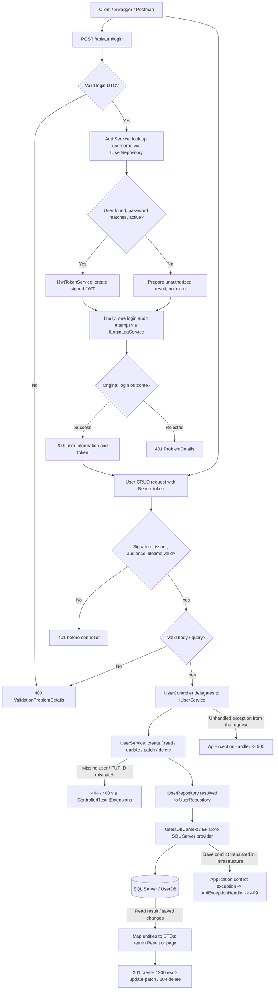

# REST API workflow

The [README](../README.md) explains the [dependency rule](../README.md#clean-architecture), [authentication success/failure sequence](../README.md#authentication-successful-and-unsuccessful-paths), and [every CRUD operation](../README.md#user-creation-and-crud-workflow). This walkthrough connects those diagrams to the implementation.

## End-to-end paths

The audit write has an independent five-second timeout; a failed write is logged and preserves the original login outcome. Exceptions and cancellation after entering `LoginAsync` also pass through its `finally` block, then propagate. DTO validation rejects malformed login requests before that method, so those requests do not create an automatic audit attempt.

## Trace a successful login

1. [`AuthController.Login`](../Controllers/AuthController.cs) receives the validated body and captures IP/User-Agent metadata.
2. [`AuthService.LoginAsync`](../src/Application/Auth/AuthService.cs) trims the username and calls `IUserRepository.GetUserByUserNameAsync`.
3. [`UserRepository`](../src/Infrastructure/Persistence/UserRepository.cs) loads the user and role through [`UsersDbContext`](../src/Infrastructure/Persistence/UsersDbContext.cs). This login lookup includes the stored hash; ordinary read projections omit it.
4. [`IUserPasswordHasher`](../src/Application/Auth/IUserPasswordHasher.cs) is resolved to [`IdentityUserPasswordHasher`](../src/Infrastructure/Auth/IdentityUserPasswordHasher.cs), which verifies the supplied password with Identity. Missing users, wrong passwords, and inactive accounts produce unauthorized results.
5. [`JwtTokenService`](../src/Infrastructure/Auth/JwtTokenService.cs) implements `IJwtTokenService` and creates the signed token and UTC expiry.
6. The `finally` block calls [`LoginLogService`](../src/Application/LoginLogs/LoginLogService.cs) once. [`LoginLogRepository`](../src/Infrastructure/Persistence/LoginLogRepository.cs) saves the record through EF Core.
7. [`ControllerResultExtensions`](../Controllers/ControllerResultExtensions.cs) maps the successful result to `200` with an `AuthLoginResponseDTO`. The client uses `token.accessToken` in the bearer header on later requests.

The API's first account comes from the SQL seed. There is no anonymous registration endpoint: log in as an existing account, create a user with `POST /api/v1/user`, then log in as the new user to obtain its token.

## Trace CRUD after authentication

Bearer authentication and authorization run before protected controller actions. Model binding/validation then checks the body and query. [`UserController`](../Controllers/UserController.cs) delegates each operation to [`UserService`](../src/Application/Users/UserService.cs):

| Operation | Application behavior | Persistence behavior | Response |
| --- | --- | --- | --- |
| Create | Build user, hash password through the security contract, set local creation/modification times. | Add entity, save, reload role details. | `201 UserDTO` and `Location`. |
| List | Calculate pagination and map entities to DTOs. | Filter, count, sort, page, and project without tracking/password data. | `200` with `pagination` and `items`. |
| Read one | Return DTO or not-found result. | Project one user and role without tracking/password data. | `200` or `404`. |
| PUT | Check route/body ID, require existing user, replace editable fields, hash supplied password, set modification time. | Load tracked entity, save, reload details. | `200`, `400` for mismatched ID, or `404`. |
| PATCH active | Require existing user, change status and modification time. | Load tracked entity, save, reload details. | `200` or `404`. |
| Delete | Require existing user. | Load tracked entity, mark deleted, save. | `204` or `404`. |

Application services do not know SQL Server or EF Core types. Repositories implement the application contracts; the scoped `DbContext` tracks writes and translates LINQ to SQL. User responses never expose passwords or hashes. A user creation response does not issue a token.

## Trace a persistence failure

A duplicate username or invalid role can violate a SQL constraint during a save. `UsersDbContext.SaveChangesAsync` catches `DbUpdateException` and throws the application-owned `PersistenceConflictException`, retaining the original exception as its cause. A `DbUpdateConcurrencyException` becomes `ConcurrencyConflictException`.

[`ApiExceptionHandler`](../ApiExceptionHandler.cs) maps these to the existing `409` titles/details and includes a `traceId`. Unexpected exceptions map to `500` with a generic client-facing message. Internal database exception details remain in server logs.

## Composition and verification

[`Program.cs`](../Program.cs) calls [`AddApplication()`](../src/Application/DependencyInjection/ApplicationServiceCollectionExtensions.cs) and [`AddInfrastructure(configuration)`](../src/Infrastructure/DependencyInjection/InfrastructureServiceCollectionExtensions.cs). Application registers use cases and the clock; Infrastructure registers repositories, EF Core, hashing, and JWT generation. Controllers receive service interfaces through constructor injection.

Run `dotnet test portfolio-users-rest-api.slnx` for regression checks using the real HTTP pipeline and test repository storage, plus EF save-error injection. Use the existing [Postman collection](../test/postman/local.users_api_collection.json) against a configured SQL Server for live persistence checks. See the [README verification section](../README.md#verification-and-postman) for setup and limitations.
